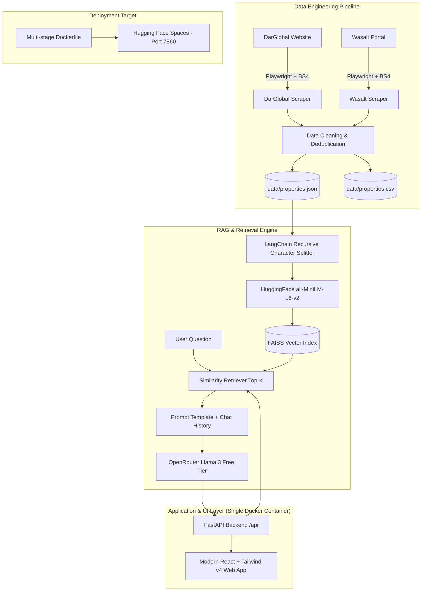

# Technical Assignment Plan: DarGlobal & Wasalt AI Real Estate Advisory System

## Executive Overview
This document outlines the end-to-end execution of a production-grade AI Real Estate Assistant grounded on real scraped data from **DarGlobal** (luxury international developer) and **Wasalt** (Saudi Arabia's premier real estate marketplace).

The solution features a complete full-stack architecture:
- **Data Engineering**: Automated Playwright + BeautifulSoup scraping pipeline outputting normalized JSON/CSV datasets.
- **RAG & Vector Search**: HuggingFace `all-MiniLM-L6-v2` embeddings + FAISS vector store with source metadata retention.
- **LLM Engine**: LangChain RAG pipeline powered by Meta Llama 3 (via OpenRouter free tier) with conversational memory and strict ground-truth citation guardrails.
- **Backend API**: Python FastAPI serving RAG querying, property catalog filters, and session management.
- **Frontend UI**: Modern React (Vite) + Tailwind CSS v4 + Lucide UI with dark/luxury theme, streaming chat, interactive property cards, source citations, and property explorer.
- **DevOps**: Multi-stage `Dockerfile` optimizing build size and memory for free-tier deployment on Hugging Face Spaces (Port 7860).

---

## Architecture Diagram

---

## Enhanced Checklist for Success

* [ ] **Phase 1: Scraping Pipeline** (Playwright scripts for DarGlobal + Wasalt saving to `data/` `.json` & `.csv`)
* [ ] **Phase 2: HuggingFace Embeddings + FAISS Vector Store** (`all-MiniLM-L6-v2` + FAISS index persistence)
* [ ] **Phase 3: LangChain RAG Pipeline with Memory & OpenRouter Llama 3** (Conversational memory + citations)
* [ ] **Phase 4: Python FastAPI Backend Service** (`/api/chat`, `/api/properties`, `/api/health`)
* [ ] **Phase 5: Modern React + Tailwind CSS v4 UI** (Luxury real estate aesthetic, streaming markdown, source citations, property explorer)
* [ ] **Phase 6: Multi-Stage Dockerfile** (Vite build + FastAPI production container on port 7860)
* [ ] **Phase 7: Hugging Face Spaces Deployment** (Automated space sync & public URL verification)
* [ ] **Phase 8: Beautifully Formatted README.md** (Architecture, screenshots, API docs, local & docker run instructions)
