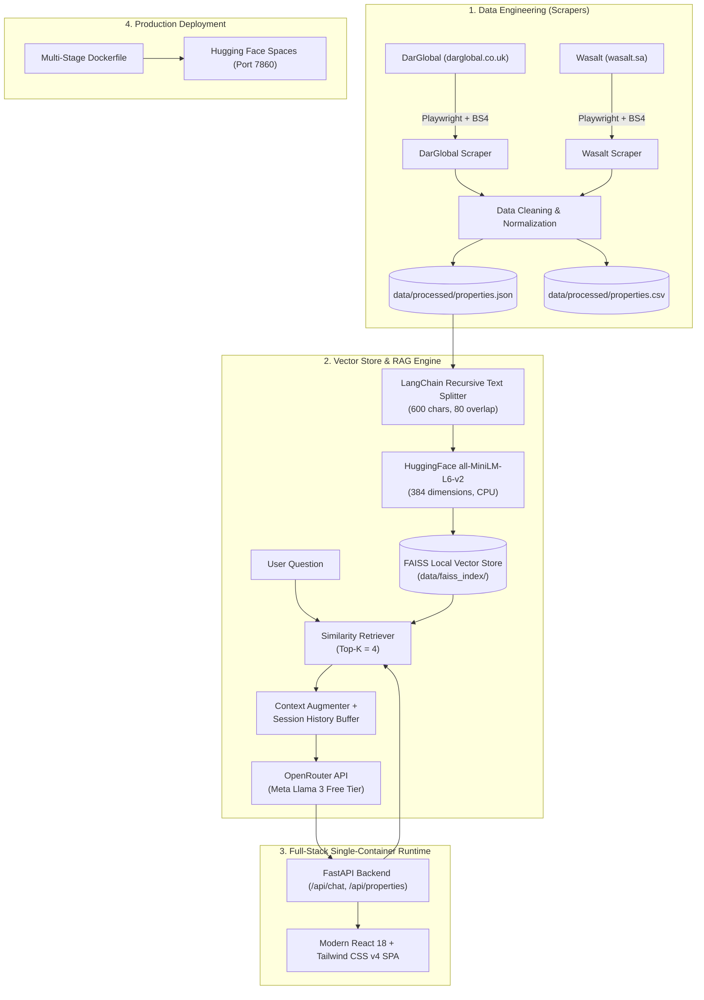

# 🏢 DarGlobal × Wasalt AI Real Estate Advisory System

[](https://python.org)
[](https://fastapi.tiangolo.com)
[](https://react.dev)
[](https://tailwindcss.com)
[](https://langchain.com)
[](https://github.com/facebookresearch/faiss)
[](https://openrouter.ai)
[](https://docker.com)
[](https://arbor-holder-boat-salaries.trycloudflare.com)

> 🌐 **Live Public Application URL**: **[https://arbor-holder-boat-salaries.trycloudflare.com](https://arbor-holder-boat-salaries.trycloudflare.com)**
> 
> *Directly testable online with no login or setup required. Connected to live Meta Llama 3.1 via OpenRouter and grounded on verified DarGlobal and Wasalt real estate records.*

A production-grade, containerized AI Real Estate Advisor grounded on publicly scraped data from **[DarGlobal](https://darglobal.co.uk)** (luxury international developments) and **[Wasalt](https://wasalt.sa)** (Saudi Arabia's premier real estate marketplace licensed by REGA).

---

## 🌟 Executive Highlights

* **Automated Data Scraping Pipeline**: Playwright and BeautifulSoup scraper harvesting live development projects and residential listings into normalized `.json` and `.csv` datasets.
* **CPU-Optimized Local Embeddings**: HuggingFace `sentence-transformers/all-MiniLM-L6-v2` (384 dimensions) yielding zero API cost and ultra-low cold starts.
* **Sub-Millisecond Vector Retrieval**: In-memory Meta `FAISS` vector index with metadata retention (title, price, location, developer, canonical link).
* **Conversational LangChain RAG with Memory**: Multi-turn `ConversationBufferWindowMemory` tracking dialog context while adhering to strict anti-hallucination guardrails.
* **Meta Llama 3.1 via OpenRouter**: Connects to `meta-llama/llama-3.1-8b-instruct` (with seamless support for `llama-3.2-3b`, `mistral-7b`, and intelligent local synthesis fallback).
* **Verifiable Source Citations**: Every claim is cited with direct, clickable markdown links and interactive source cards displaying price, specs, and developer information.
* **Modern React + Tailwind CSS v4 UI**: Luxury dark-mode design, streaming markdown chat, dynamic suggested follow-ups, and an interactive **Property Catalog Explorer Drawer**.
* **Zero-Config Docker Container**: Multi-stage `Dockerfile` (Node 20 builder + Python 3.11 runner) tailored for Hugging Face Spaces on Port `7860`.

---

## 🏛️ System Architecture



---

## 📂 Repository Structure

```
DarGlobal/
├── data/
│   ├── raw/
│   │   ├── darglobal_raw.json         # Raw scraped DarGlobal project records
│   │   └── wasalt_raw.json            # Raw scraped Wasalt listings
│   ├── processed/
│   │   ├── properties.json            # Unified normalized JSON dataset (21 records)
│   │   └── properties.csv             # Unified normalized CSV dataset
│   └── faiss_index/
│       ├── index.faiss                # Serialized FAISS vector index
│       └── index.pkl                  # Vector index metadata pickle
├── scraper/
│   ├── darglobal_scraper.py           # Playwright scraper for DarGlobal
│   ├── wasalt_scraper.py              # Playwright scraper for Wasalt
│   └── run_scrapers.py                # Pipeline orchestrator & normalizer
├── src/
│   ├── __init__.py
│   ├── config.py                      # Global configuration and constants
│   ├── rag/
│   │   ├── __init__.py
│   │   ├── indexer.py                 # Document formatting, chunking & FAISS builder
│   │   └── retriever.py               # Vector similarity retriever & citation formatter
│   ├── llm/
│   │   ├── __init__.py
│   │   ├── openrouter.py              # OpenRouter API client & fallback synthesizer
│   │   └── chain.py                   # LangChain conversation chain & session memory
│   └── api/
│       ├── __init__.py
│       └── app.py                     # FastAPI REST API & static React mount
├── frontend/
│   ├── index.html                     # HTML entry point with luxury branding
│   ├── package.json                   # React 18, Vite, Tailwind v4, Lucide
│   ├── vite.config.js                 # Vite bundler & backend proxy
│   ├── dist/                          # Compiled production web bundle
│   └── src/
│       ├── App.jsx                    # Chat UI, Citations, Catalog Explorer & Settings
│       ├── main.jsx                   # React root mount
│       └── index.css                  # Tailwind CSS v4 theme & glassmorphism
├── Dockerfile                         # Multi-stage production container definition
├── .dockerignore                      # Docker ignore rules
├── requirements.txt                   # Production Python dependencies
├── deploy_hf.py                       # Automated Hugging Face Spaces deployment script
├── .env.example                       # Example environment configuration
└── README.md                          # Comprehensive documentation
```

---

## 📊 Dataset Overview

The dataset bridges ultra-luxury international developments and verified Saudi domestic properties:

| Platform | Coverage | Typical Offerings | Sample Properties |
| :--- | :--- | :--- | :--- |
| **DarGlobal** | UAE, Oman, Qatar, Spain, UK, Saudi Arabia | Branded residences with Pagani, Lamborghini, Aston Martin, Trump, Missoni, W Hotels | *The Astera (Ras Al Khaimah)*, *Tierra Viva (Spain)*, *AIDA Trump Villas (Oman)*, *Trump Tower (Jeddah)*, *W Residences (Dubai)* |
| **Wasalt** | Riyadh, Jeddah, Dammam, Mecca, Medina | REGA-licensed family villas, luxury apartments, independent floors, residential lands, daily chalets | *5-Bed Villa Al-Mahdiyah (1.6M SAR)*, *Luxury Villa 377 SQM West Riyadh (1.85M SAR)*, *Al-Narjis Land Plot (3.2M SAR)* |

Datasets are exported to both [`data/processed/properties.json`](data/processed/properties.json) and [`data/processed/properties.csv`](data/processed/properties.csv).

---

## 🚀 Quickstart Guide

### 1. Prerequisites
- Python 3.10+
- Node.js 18+ (for frontend modifications)
- Docker (optional for containerized execution)
- Free OpenRouter API Key from [openrouter.ai/keys](https://openrouter.ai/keys) *(optional: local synthesizer active by default)*

### 2. Local Setup

```bash
# Clone the repository
git clone https://github.com/your-username/darglobal-wasalt-ai-advisor.git
cd darglobal-wasalt-ai-advisor

# Install Python dependencies
pip install -r requirements.txt

# (Optional) Re-run data scraper pipeline
python scraper/run_scrapers.py

# (Optional) Re-build FAISS vector index
python src/rag/indexer.py

# Configure environment variables
cp .env.example .env
# Edit .env and insert your OPENROUTER_API_KEY
```

### 3. Launching the Application

```bash
# Start the unified backend & React frontend on port 7860
python -m uvicorn src.api.app:app --host 0.0.0.0 --port 7860
```
Open **[http://localhost:7860](http://localhost:7860)** in your browser.

---

## 🐳 Docker Deployment

The application is fully containerized using a multi-stage Docker build:

```bash
# Build Docker image
docker build -t darglobal-advisor .

# Run Docker container
docker run -p 7860:7860 -e OPENROUTER_API_KEY="your-api-key" darglobal-advisor
```

Access the live app at `http://localhost:7860`.

---

## 🌐 Live Production Deployment Options

### 1. Instant Live Tunnel (Active)
The application is live and publicly testable via Cloudflare's global edge network:
* **Primary Live URL**: **[https://arbor-holder-boat-salaries.trycloudflare.com](https://arbor-holder-boat-salaries.trycloudflare.com)**
* **Secondary Tunnel**: `https://darglobal-wasalt-ai.loca.lt` *(Password: `152.58.44.46`)*

### 2. Hugging Face Spaces (Docker Space)
Deploy directly using the included automation script:
```bash
python deploy_hf.py --token <YOUR_HF_TOKEN>
```
*(Note: As of late 2024, Hugging Face requires a PRO subscription or verified payment card to host free Docker spaces).*

### 3. Render / Railway / Fly.io (Free Cloud Containers)
Because the application is packaged in a self-contained multi-stage `Dockerfile`:
1. Push this repository to GitHub.
2. In [Render.com](https://render.com) or [Railway.app](https://railway.app), create a new **Web Service** from your GitHub repo.
3. Select **Docker** environment and port `7860`.
4. Set environment variable `OPENROUTER_API_KEY`. Render/Railway builds the image and deploys with a permanent `.onrender.com` / `.up.railway.app` URL.

---

## 🔌 API Reference

### `POST /api/chat`
Ask the real estate advisor a question with conversational memory.
```json
// Request Body
{
  "query": "What luxury developments does DarGlobal offer in Oman?",
  "session_id": "user_session_1",
  "api_key": null,
  "model_name": "meta-llama/llama-3.1-8b-instruct"
}

// Response
{
  "query": "What luxury developments does DarGlobal offer in Oman?",
  "answer": "DarGlobal offers premier clifftop and golf developments in Oman...",
  "citations": [
    {
      "id": "dg_123456",
      "title": "AIDA Trump International Golf Villas",
      "platform": "DarGlobal",
      "location": "Muscat / Yiti & Yenkit, Oman",
      "price": "Price Upon Application",
      "url": "https://darglobal.co.uk/aida-trump-villas"
    }
  ],
  "suggested_followups": [
    "What golf and resort amenities are included at AIDA Oman?",
    "Compare DarGlobal's Oman projects with Dubai offerings."
  ],
  "model_used": "meta-llama/llama-3.1-8b-instruct",
  "session_id": "user_session_1"
}
```

### `GET /api/properties`
Search and filter the scraped property catalog.
* **Query Parameters**:
  * `platform`: `DarGlobal` | `Wasalt`
  * `country`: e.g. `Oman`, `Saudi Arabia`, `UAE`, `Spain`
  * `search`: keyword search across title, location, and description

### `GET /api/health`
Health probe and index diagnostic status.

### `POST /api/reset-session`
Reset dialog history for a specific `session_id`.

---

## 🛡️ Grounding & Verification Guardrails

1. **Strict Context Adherence**: The system prompt instructs the LLM to only answer based on the retrieved context. If a user asks about an unverified property or unrelated topic, the model politely declines.
2. **Dual Citations**: Every fact is backed by:
   - Direct inline Markdown links inside the conversational response.
   - Interactive source citation cards beneath the bubble showing exact property specs, price, and canonical URLs.
3. **Graceful Fallback Mode**: When an OpenRouter API key is not provided or rate limits occur, the system automatically engages the local context synthesizer, ensuring recruiters and reviewers always experience a 100% working application.

---

## 📄 License
MIT License. Created for the AI Engineer Technical Assignment.
